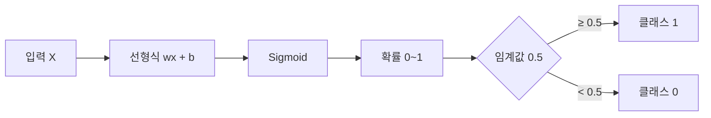
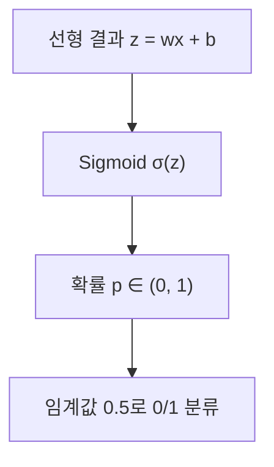

# 세션 15: 머신 러닝 5 — 회귀 심화 · 로지스틱 회귀

<!-- session-nav -->
**이동:** [← 세션 14](./session14.md) · [세션 16 →](./session16.md)

session10(회귀 입문)의 연장. 단순·다중·규제는 짧게 복습하고, **로지스틱 회귀·Sigmoid**를 중심으로 정리합니다.

> **이 세션이 하는 일 (쉬운 말)**  
> 지난번에 “숫자를 맞추는 법”(회귀)을 배웠습니다.  
> 오늘은 그걸 조금 더 단단하게 복습한 뒤,  
> **“예 / 아니오”를 가리는 법**(분류)으로 넘어갑니다.  
> 그 다리 역할을 하는 도구가 **로지스틱 회귀**와 **Sigmoid**입니다.

---

## 1. 단순 선형회귀

- 한 원인 \( X \) → 결과 \( Y \)
- 식: \( y = wx + b \) (직선)
- 예: 키 → 몸무게. 흩어진 점의 **전체 흐름**을 가장 잘 나타내는 직선을 찾음

> **쉽게 이해하기**  
> **단순 선형회귀**는 흩어진 점들의 대체적인 흐름을 **한 직선**으로 잡는 방법입니다.  
> 식 \( y = wx + b \)에서 \( x \)는 원인, \( y \)는 예측 결과, \( w \)는 원인이 1 늘 때 결과가 얼마나 변하는지, \( b \)는 시작 높이입니다.  
> 목표는 실제 점과 직선 사이 차이가 최소가 되도록 \( w \), \( b \)를 찾는 것입니다.

---

## 2. 다중 선형회귀

- \( X_1, X_2, X_3, \ldots \) → \( Y \)
- 평면(또는 다차원 초평면)으로 맞춤
- 예: 키·나이·운동량 → 몸무게. 각 요인의 영향을 **합산**

> **쉽게 이해하기**  
> **다중 선형회귀**는 원인이 여러 개일 때 한꺼번에 맞추는 방법입니다.  
> 예측 ≈ (키 영향) + (나이 영향) + (운동량 영향) + 기본값처럼 각 원인마다 \( w \) 하나씩 배웁니다.  
> 그림은 어려워도 아이디어는 같습니다. 여러 손잡이를 동시에 맞춰 오차를 줄입니다.

---

## 3. 경사하강법 (Gradient Descent)

- 최적 기울기 \( w \), 절편 \( b \)를 찾는 방법
- 비유: 눈 감고 산에서 **골짜기(최소 오차)**로 조금씩 내려감
- 조금씩 이동 = **학습률**, 골짜기 도착 = 데이터에 가장 잘 맞는 직선/평면

| 용어          | 비유        |
| ------------- | ----------- |
| 단순 선형회귀 | 직선        |
| 다중 선형회귀 | 평면        |
| 경사하강법    | 산 내려가기 |

> **쉽게 이해하기**  
> **경사하강법(Gradient Descent, 오차가 줄어드는 방향으로 조금씩 고치기)** 은 처음부터 정답 \( w \), \( b \)를 모를 때 쓰는 방법입니다.  
> 예측 → 오차 확인 → \( w \), \( b \) 수정을 반복하며, 오차가 가장 작은 지점을 찾습니다.  
> **학습률(learning rate, 한 번에 얼마나 크게 고칠지)** 이 너무 크면 지나치고, 너무 작으면 시간이 오래 걸립니다.

---

## 4. 규제가 필요한 이유

- feature가 많거나 **다중공선성**이 있으면 성능↓, 계수가 과도하게 커질 수 있음
- → **Regularization**으로 가중치를 통제

> **쉽게 이해하기**  
> **특성(feature, 모델에 넣는 원인 정보)** 이 너무 많으면 학습 데이터만 외운 **과적합(overfitting, 새 데이터에서 약함)** 이 납니다.  
> **다중공선성**은 키와 팔 길이처럼 서로 겹치는 정보가 있을 때 계수 \( w \)가 흔들리는 상태입니다.  
> **규제(Regularization)** 는 계수가 커질수록 벌점을 줘 모델을 단순하게 유지합니다.

---

## 5. L1 Lasso

- \( |w| \) 합에 패널티 → 일부 계수를 **0**으로 → 변수 선택
- \( \mathrm{Loss} = \sum (y - \hat{y})^2 + \alpha \sum |w| \)
- \( \alpha \): 규제 강도
- **Ridge vs Lasso**: Ridge는 0을 만들지 않음 / Lasso는 **희소 모델**

> **쉽게 이해하기**  
> **Lasso**는 계수 **절댓값** 합에 벌점을 줍니다.  
> 중요하지 않은 변수는 계수를 **0**으로 만들어 예측에서 빼 주므로 변수 선택에 유리합니다.  
> \( \alpha \)가 클수록 벌이 세져 0이 되는 계수가 늘어납니다.  
> 계수 대부분이 0인 가벼운 모델을 **희소 모델(sparse model)** 이라고 부릅니다.

---

## 6. L2 Ridge

- \( w^2 \) 합. 큰 가중치에 더 큰 규제 → 균등하게 축소
- \( \mathrm{Loss} = \sum (y - \hat{y})^2 + \alpha \sum w^2 \)
- 과적합 방지, 일반화↑, **희소성 없음**

> **쉽게 이해하기**  
> **Ridge**는 계수 **제곱**에 벌점을 줍니다. 큰 계수일수록 벌이 더 큽니다.  
> Lasso와 달리 계수를 줄이되 보통 **0까지는 만들지 않습니다**.  
> 변수 선택보다 과적합을 부드럽게 막을 때 자주 씁니다.

---

## 7. ElasticNet

- L1 + L2 혼합
- \( \mathrm{Loss} = \sum (y - \hat{y})^2 + \alpha \bigl( \rho \sum |w| + (1-\rho) \sum w^2 \bigr) \)
- \( \rho \) (`l1_ratio`): 1 = Lasso, 0 = Ridge
- 변수가 많거나 상관이 있을 때 Lasso보다 **더 안정적**

> **쉽게 이해하기**  
> **ElasticNet**은 Lasso와 Ridge를 섞은 방법입니다.  
> \( \rho \)(`l1_ratio`)가 1이면 Lasso에 가깝고, 0이면 Ridge에 가깝습니다.  
> 비슷한 변수가 많을 때 Lasso만 쓰면 하나만 남기고 끄는 일이 생겨, 섞으면 더 안정적인 경우가 많습니다.

---

## 8. Diamonds 데이터셋 (실습 후보)

- Kaggle: https://www.kaggle.com/datasets/shivam2503/diamonds
- `cut`, `color`, `clarity`, `price` 등으로 회귀·전처리 연습에 쓰기 좋음

> **쉽게 이해하기**  
> 연습용 **다이아몬드** 표입니다. 한 줄이 다이아 하나이고, `price`가 맞출 가격입니다.  
> 문자 등급(`cut`, `color`, `clarity`)과 숫자 특징으로 가격 회귀·**전처리** 연습에 쓰입니다.

---

## 9. Logistic Regression (핵심)

- 이름은 회귀지만, 실제로는 **분류** (확률 예측)
- 예: 스팸 여부, 병 여부
- 먼저 \( y = wx + b \)를 구한 뒤, **Sigmoid**로 0~1 확률로 변환
- 선형회귀는 MSE 계열로 연속값을 맞춤 / 로지스틱은 **Cross-Entropy** 손실을 GD로 최소화

| 구분 | 선형회귀         | 로지스틱 회귀        |
| ---- | ---------------- | -------------------- |
| 출력 | 연속값           | 확률 (0~1) → 분류    |
| 변환 | 없음 (직선/평면) | Sigmoid              |
| 손실 | MSE 계열         | Cross-Entropy        |
| 용도 | 집값, 몸무게     | 스팸/정상, 양성/음성 |

### 왜 “회귀”라는 이름인가?

- 안쪽의 **선형식** \( wx + b \)는 회귀와 같음
- 다만 Sigmoid로 확률화한 뒤 임계값으로 0/1 **분류**



> **쉽게 이해하기**  
> **로지스틱 회귀**는 이름과 달리 **분류**를 합니다. 집값이 아니라 스팸 여부처럼 어느 쪽인지 가릅니다.  
> 1단계: \( z = wx + b \)로 점수를 만듭니다. 2단계: **Sigmoid**로 0~1 **확률**로 바꿉니다. 3단계: 보통 0.5 기준으로 0 또는 1을 고릅니다.  
> 손실은 연속 오차가 아닌 **Cross-Entropy(확률 예측의 틀림)** 를 줄이며, 학습은 경사하강법과 같습니다.

---

## 10. Sigmoid

- 출력이 항상 **0~1**, S자 곡선
- 입력↑ → 1에 가까움, ↓ → 0에 가까움, 입력이 0이면 **0.5**
- 임계값 0.5: \( \ge 0.5 \) → 1, \( < 0.5 \) → 0
- **왜 쓰나**: 선형 결과는 음수이거나 1을 넘을 수 있음 → Sigmoid로 **확률화**



> **쉽게 이해하기**  
> 선형 점수 \( z \)는 음수나 1을 넘을 수 있어 확률로 쓰기 어렵습니다.  
> **Sigmoid**는 어떤 \( z \)든 **0~1** 사이로 눌러 주는 S자 변환입니다. \( z = 0 \)이면 0.5입니다.  
> 그다음 0.5를 넘으면 한쪽 클래스로 자릅니다. 임계값 0.5는 기본이며, 필요하면 0.3처럼 바꿀 수 있습니다.

---

## 전체 지도 (한눈에)

```text
[숫자 맞추기 = 회귀]
  단순: 원인 1개 → 직선
  다중: 원인 여러 개 → 합쳐서 맞춤
  학습: 경사하강법 (오차 골짜기로 내려가기)
  과적합 방지: 규제
    Lasso  = 불필요 변수 끄기(0)
    Ridge  = 계수 고르게 줄이기
    ElasticNet = 둘 섞기

[예/아니오 = 분류]  ← 이번 핵심
  로지스틱 회귀
    선형식으로 점수 → Sigmoid로 확률 → 임계값으로 0/1
```

---

## 복습 체크 (스스로)

1. 단순 선형회귀와 다중 선형회귀의 차이는 무엇인가요?
2. 규제를 넣는 이유를, “시험 공부”에 비유해 말해 보세요.
3. Lasso와 Ridge의 가장 큰 차이는 무엇인가요?
4. 로지스틱 회귀는 왜 이름에 “회귀”가 들어가나요? 실제로는 무엇을 하나요?
5. Sigmoid가 없으면 무엇이 불편한가요?

답 보기

1. 단순 = 원인 1개(직선). 다중 = 원인 여러 개를 합쳐 맞춤.
2. 규제 없으면 학습 데이터만 외우듯 과적합. 규제 = “너무 복잡한 답 쓰지 마” 벌점 → 새 문제에도 버티게.
3. Lasso는 계수를 0으로 만들어 변수를 끔. Ridge는 0으로 거의 안 만들고 크기만 줄임.
4. 안쪽이 \( wx+b \) 선형식이라 회귀처럼 보이지만, Sigmoid+임계값으로 **분류**를 함.
5. 선형 점수가 음수이거나 1을 넘을 수 있어 확률로 해석하기 어려움. Sigmoid가 0~1로 눌러 줌.

<!-- session-nav -->
**이동:** [← 세션 14](./session14.md) · [세션 16 →](./session16.md)
